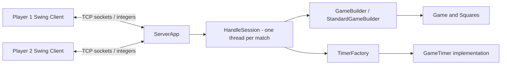
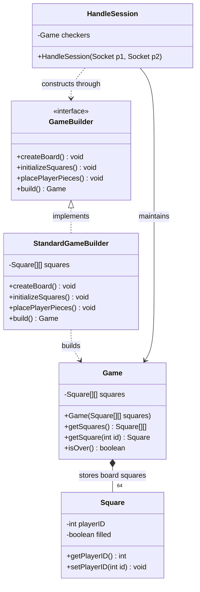
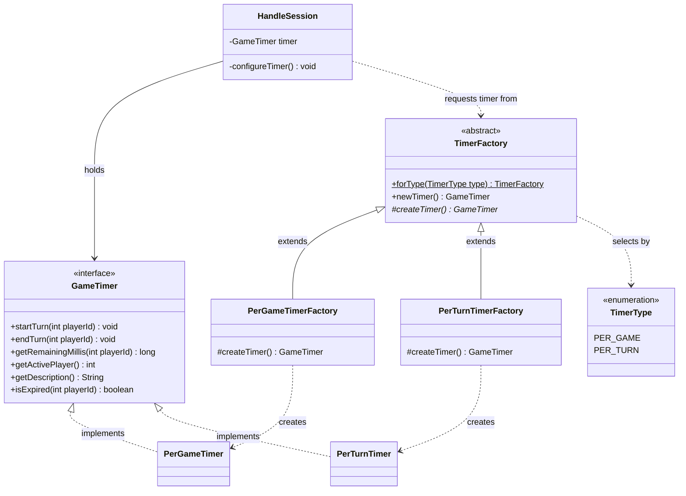
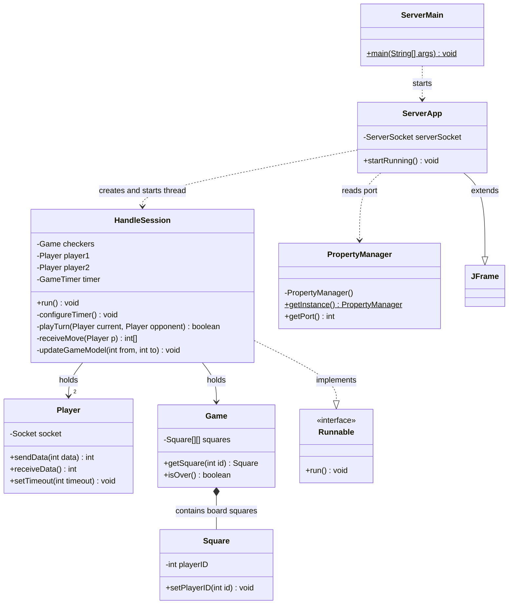
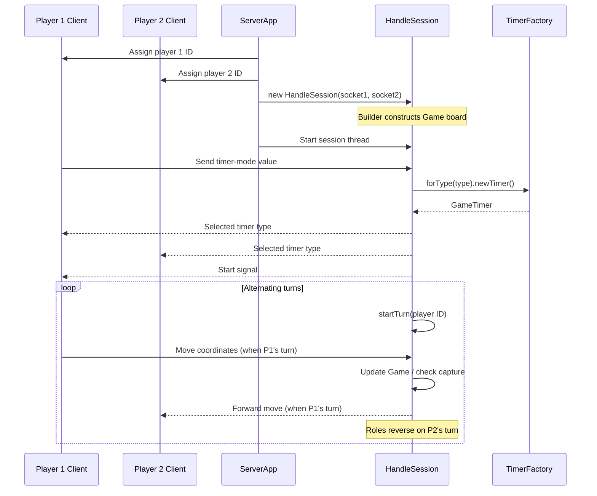

# Checkers — Stage 1 | Creational Design Patterns

A Java two-player networked Checkers project demonstrating **Builder** and **Factory Method** on the server. The repository also contains a Swing client, socket-based communication, and timer selection.

> **Scope:** This documentation describes the supplied project source. The primary design-pattern focus is the **server**. The client is retained for gameplay and timer-mode interaction.

## Contents
- [Architecture](#architecture)
- [Creational patterns](#creational-patterns)
- [Server UML](#server-uml)
- [Sequence diagram](#sequence-diagram)
- [Project structure](#project-structure)
- [Game flow](#game-flow)
- [Running the project](#running-the-project)
- [Implementation reference](#implementation-reference)
- [Limitations](#limitations)

## Architecture



The server waits for two connections, assigns player IDs, creates a `HandleSession` thread, constructs a game board with the builder, and selects a timer according to player one's choice.

## Creational patterns

### 1. Builder — game-board construction



`HandleSession` creates a `StandardGameBuilder` through the `GameBuilder` interface, calls the construction steps, then retrieves the `Game` via `build()`.

### 2. Factory Method — timer creation



`TimerFactory.forType(type).newTimer()` selects a concrete creator and invokes its overridden factory method `createTimer()`. **Per-game** allows five minutes total per player; **per-turn** gives 30 seconds per turn.

### 3. Singleton-style configuration

`PropertyManager` uses a private constructor, a static `INSTANCE` field, and `getInstance()` to load the server port from `config.properties`. It is a lazy singleton-style implementation, **not thread-safe** if initialized concurrently.

## Server UML



See the more focused pattern diagrams above for builder and timer relationships. UML shows the **design represented by the source**, not runtime validation.

## Sequence diagram



## Project structure

```text
checkers-design-patterns-master/
├── README.md                     # This documentation
├── docs/                         # Separate architecture / UML guide
├── Documentation/                # Existing project images
├── Checkers - Server/
│   ├── src/
│   │   ├── ServerMain.java
│   │   ├── ServerApp.java
│   │   ├── PropertyManager.java
│   │   ├── Session/HandleSession.java
│   │   ├── Model/                 # Game, Square, Player, builders
│   │   ├── Timing/                # Timer interface and factories
│   │   └── EnumConstants/
│   ├── resources/config.properties
│   └── doc/                      # Existing server UML files
└── Checkers - Client/
    ├── src/                      # Swing UI, handlers, models, timing
    ├── resources/config.properties
    └── doc/                      # Existing client UML files
```

## Game flow

1. Start the server, which reads its port from `config.properties`.
2. Start two clients and connect them to the server.
3. The server pairs the clients and creates a `HandleSession` in a thread.
4. The builder creates an 8×8 board with initial pieces.
5. Player one selects the timer mode; the factory creates the matching timer.
6. Players alternate turns; the server receives coordinates, updates the model, and forwards moves.
7. The server signals a win/loss when its game-over condition is reached or a player's time expires.

## Running the project

This is a **plain Java / Eclipse-style project**, with `.project` and `.classpath` files, not a Maven or Gradle project.

**Recommended:** Import `Checkers - Server` and `Checkers - Client` as existing Java projects into Eclipse (or configure equivalent Java source folders and resource paths in your IDE). Run `ServerMain` first, then launch `ClientMain` twice. Ensure `resources/config.properties` is available on the runtime classpath for each project and check the host/port configuration before connecting.

If compiling manually, place the compiled output and each project's resources on its classpath. Java and Swing are required. The supplied ZIP contains pre-existing `.class` files, but rebuilding from source is preferable.

## Implementation reference

| Concern | Main classes | Source location |
|---|---|---|
| Server entry point | `ServerMain`, `ServerApp` | `Checkers - Server/src/` |
| Session handling | `HandleSession` | `Checkers - Server/src/Session/` |
| Board construction | `GameBuilder`, `StandardGameBuilder` | `Checkers - Server/src/Model/` |
| Game state | `Game`, `Square`, `Player` | `Checkers - Server/src/Model/` |
| Timer factories | `TimerFactory`, `PerGameTimerFactory`, `PerTurnTimerFactory` | `Checkers - Server/src/Timing/` |
| Timer products | `GameTimer`, `PerGameTimer`, `PerTurnTimer` | `Checkers - Server/src/Timing/` |
| Timer choice | `TimerType` | `Checkers - Server/src/EnumConstants/` |
| Client UI | `BoardPanel`, `SquarePanel`, `TimerPanel` | `Checkers - Client/src/View/` |

## Limitations

- Diagrams and explanations were derived from the uploaded Java source; they are **not** evidence of successful end-to-end execution.
- The server's `updateGameModel` updates destination/source and removes a jumped piece, but does not itself enforce all legal Checkers moves. Some move validation may be handled by the client.
- The server's turn loop alternates players; multi-jump continuation is not implemented in that loop.
- The source includes both client and server. Only the **server-side creational design patterns** are emphasized here.
- Existing `.ucls` / `.png` diagrams are preserved in each project's `doc/` folder.

---
Documentation prepared from the supplied project snapshot; source code left unchanged.
